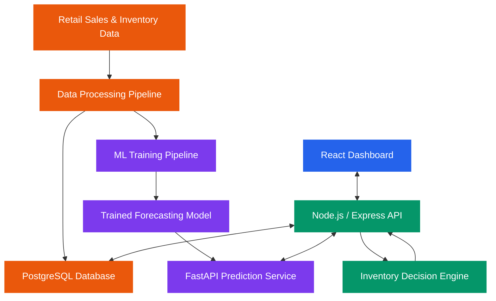
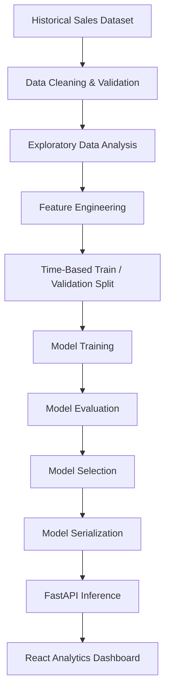

<div align="center">

# 🛒 RetailIQ
### AI-Powered Retail Demand Forecasting & Inventory Optimization

**An End-to-End Intelligent Retail Analytics Platform**

*Transforming Retail Data into Predictive Insights and Smarter Inventory Decisions.*

<br>


<br>

[](https://github.com/tirthgandhi/RetailIQ-AI-Demand-Forecasting-Inventory-Optimization/stargazers)
[](https://github.com/tirthgandhi/RetailIQ-AI-Demand-Forecasting-Inventory-Optimization/forks)
[](https://github.com/tirthgandhi/RetailIQ-AI-Demand-Forecasting-Inventory-Optimization/issues)

**Project Status:** 🟡 Planning & Development

[Overview](#-project-overview) •
[Features](#-key-features) •
[Architecture](#-system-architecture) •
[ML Pipeline](#-machine-learning-pipeline) •
[Getting Started](#-getting-started) •
[Roadmap](#-development-roadmap)

</div>

---

## 📌 Project Overview

**RetailIQ** is an AI-powered retail intelligence platform designed to help businesses optimize inventory, forecast product demand, analyze sales performance, and make data-driven decisions.

The project combines **Artificial Intelligence, Machine Learning, Data Science, Data Analytics, Data Engineering, and Full-Stack Web Development** into a unified solution.

RetailIQ aims to transform historical sales data into actionable business insights through predictive modeling, interactive dashboards, and intelligent inventory recommendations.

The platform is being designed to demonstrate an end-to-end workflow, from raw data collection and preprocessing to machine learning model deployment and business intelligence visualization.

### 🎯 Project Vision

> To build an intelligent, scalable, and data-driven retail management platform that reduces inventory uncertainty, improves demand planning, and helps businesses make informed operational decisions.

---

## 🚨 Problem Statement

Retail businesses frequently struggle to maintain the correct balance between product supply and customer demand.

Traditional inventory management solutions primarily focus on tracking stock availability rather than accurately forecasting future demand.

This creates several business challenges:

- **Stockouts:** Insufficient inventory results in missed sales opportunities.
- **Overstocking:** Excess inventory increases storage and operational costs.
- **Inaccurate Forecasting:** Traditional estimation methods struggle with fluctuating customer demand.
- **Seasonal Demand:** Holidays, promotions, and seasonal trends affect purchasing behavior.
- **Limited Insights:** Businesses often lack effective visualization and predictive decision-support tools.
- **Manual Decision-Making:** Inventory replenishment decisions may depend on assumptions rather than data.

### 💡 Proposed Solution

RetailIQ aims to solve these challenges by developing an intelligent platform capable of:

1. Analyzing historical retail sales and transactional data.
2. Forecasting future product demand using machine learning.
3. Identifying seasonal patterns and sales trends.
4. Detecting unusual sales fluctuations.
5. Generating inventory replenishment recommendations.
6. Visualizing key business performance indicators.
7. Supporting data-driven retail operations through a centralized web dashboard.

---

## ✨ Key Features

The following capabilities are planned for the platform.

### 🤖 Artificial Intelligence & Machine Learning

- Product-level demand forecasting.
- Multi-horizon forecasts for 7, 14, and 28 days.
- Historical trend and seasonality analysis.
- Machine learning model comparison.
- Feature importance and explainability using SHAP.
- Unusual sales pattern detection.
- Forecast accuracy evaluation.
- Prediction APIs for application integration.

### 📊 Data Science & Analytics

- Exploratory Data Analysis (EDA).
- Data preprocessing and cleaning.
- Missing-value handling and validation.
- Time-series feature engineering.
- Sales and revenue analysis.
- Product category performance analysis.
- Seasonal and historical trend visualization.
- Interactive KPI reports.

### 📦 Inventory Optimization

- Inventory risk classification.
- Low-stock and potential stockout alerts.
- Overstock identification.
- Demand-based replenishment recommendations.
- Safety stock estimation.
- Reorder point calculation.
- Supplier lead-time considerations.
- Inventory performance monitoring.

**Note:** Inventory optimization requires inventory-specific inputs such as current stock, lead time, and ordering constraints. These will be maintained separately from historical sales data.

### 💻 Full-Stack Application

- Secure authentication and role-based access.
- Responsive retail analytics dashboard.
- Inventory and product management.
- Sales analytics visualization.
- Demand prediction interface.
- REST API integration.
- Search, filters, and reports.
- Model prediction history and monitoring.

---

## 🛠️ Technology Stack

RetailIQ is planned around modern technologies used in machine learning engineering, data analytics, and production-oriented application development.

### Frontend Development


### Backend Development


### AI, Machine Learning & Data Science


### Database & Data Visualization


### DevOps & Development Tools


---

## 🏗️ System Architecture

The proposed architecture separates user-facing application functionality, business logic, database operations, and machine learning inference.



### Architecture Components

| Layer | Technology | Responsibility |
|---|---|---|
| Presentation | React, TypeScript | User interface and dashboards |
| Application API | Node.js, Express | Authentication and business logic |
| ML Inference API | Python, FastAPI | Serve demand predictions |
| Database | PostgreSQL | Store business and inventory records |
| Data Processing | Pandas, NumPy | Data cleaning and feature engineering |
| ML Engine | XGBoost, LightGBM | Train and evaluate forecasting models |
| Visualization | Recharts, Plotly | Interactive analytical reporting |
| Deployment | Docker, CI/CD | Containerization and automation |

---

## 🧠 Machine Learning Pipeline

The proposed machine learning workflow consists of the following stages.



### Planned Models

| Algorithm | Purpose |
|---|---|
| Seasonal Naive Forecast | Establish a simple baseline |
| Random Forest Regressor | Model nonlinear relationships |
| XGBoost Regressor | Gradient boosting-based demand prediction |
| LightGBM Regressor | Efficient forecasting on structured data |

### Feature Engineering

Potential predictive features include:

- Historical daily sales.
- Lagged sales values.
- Rolling averages and rolling statistics.
- Product identifiers and categories.
- Store identifiers.
- Day of week and month.
- Holiday and event indicators.
- Historical selling prices.
- Available promotional information.
- Seasonal sales trends.

Only information available at prediction time should be used to avoid data leakage.

### Model Evaluation

Planned performance metrics:

- **MAE:** Mean Absolute Error.
- **RMSE:** Root Mean Squared Error.
- **WAPE:** Weighted Absolute Percentage Error.
- **WRMSSE:** Weighted Root Mean Squared Scaled Error, where applicable to M5 evaluation.

Model performance will be measured using chronological validation and backtesting.

Actual evaluation results will be added after experiments are completed.

---

## 📂 Dataset Information

### Walmart M5 Forecasting Dataset

The project plans to use the publicly available **M5 Forecasting – Accuracy** dataset from Kaggle.

**Dataset Link:**

https://www.kaggle.com/competitions/m5-forecasting-accuracy/data

The dataset contains historical sales information for Walmart products across multiple stores.

### Main Dataset Components

| Dataset | Description |
|---|---|
| `sales_train_validation.csv` | Historical daily product sales |
| `calendar.csv` | Dates, events, and calendar information |
| `sell_prices.csv` | Historical product selling prices |

### Dataset Applications

- Demand forecasting.
- Store-level and product-level sales analysis.
- Holiday and event-based analysis.
- Feature engineering.
- Forecast evaluation and model comparison.

**Important Dataset Limitation:**

The M5 data does not include actual inventory-on-hand records, supplier lead times, or procurement decisions.

The inventory optimization component will therefore require additional data. Simulated inventory scenarios may be used during development and will be clearly identified as simulated.

Dataset usage will follow the applicable Kaggle competition and data terms.

---

## 🖥️ Planned Application Modules

### 1. Dashboard Module

Displays key retail performance indicators:

- Total sales and revenue.
- Sales trends.
- Top-performing products.
- Demand forecast summaries.
- Inventory risk indicators.
- Product category analytics.

### 2. Sales Analytics Module

Provides analytical insights into:

- Daily, weekly, and monthly sales.
- Product demand patterns.
- Historical performance.
- Sales distribution.
- Store-wise comparisons.

### 3. AI Forecasting Module

Provides:

- Product-level predictions.
- Forecast horizon selection.
- Actual-versus-predicted visualizations.
- Forecast model information.
- Historical prediction performance.

### 4. Inventory Intelligence Module

Provides:

- Available stock analysis.
- Stockout risk indicators.
- Reorder suggestions.
- Safety stock calculations.
- Inventory health summaries.

### 5. Administration Module

Provides:

- Authentication and access management.
- Product and inventory records.
- Data import management.
- System configuration.
- Prediction and application monitoring.

---

## 📁 Proposed Project Structure

The following structure is a development blueprint and may evolve during implementation.

```text
RetailIQ-AI-Demand-Forecasting-Inventory-Optimization/
│
├── frontend/
│   ├── public/
│   ├── src/
│   │   ├── assets/
│   │   ├── components/
│   │   ├── pages/
│   │   ├── services/
│   │   ├── hooks/
│   │   ├── types/
│   │   └── App.tsx
│   └── package.json
│
├── backend/
│   ├── src/
│   │   ├── config/
│   │   ├── controllers/
│   │   ├── middleware/
│   │   ├── routes/
│   │   ├── services/
│   │   └── app.js
│   └── package.json
│
├── ml-service/
│   ├── app/
│   │   ├── main.py
│   │   ├── schemas/
│   │   └── services/
│   ├── requirements.txt
│   └── tests/
│
├── machine-learning/
│   ├── notebooks/
│   ├── preprocessing/
│   ├── training/
│   ├── evaluation/
│   └── models/
│
├── data/
│   ├── raw/
│   ├── processed/
│   └── README.md
│
├── database/
│   ├── migrations/
│   └── seeds/
│
├── docs/
│   ├── architecture/
│   ├── api/
│   └── screenshots/
│
├── tests/
│
├── .github/
│   └── workflows/
│
├── .gitignore
├── .env.example
├── docker-compose.yml
└── README.md
```

> The structure above is planned. Files and directories will be added progressively as development proceeds.

---

## 🚀 Getting Started

### Prerequisites

Recommended development tools:

- Git
- Node.js and npm
- Python 3.11 or newer
- PostgreSQL
- Docker (optional)
- VS Code or another development IDE

### 1. Clone the Repository

```bash
git clone https://github.com/tirthgandhi/RetailIQ-AI-Demand-Forecasting-Inventory-Optimization.git
```

### 2. Navigate to the Project

```bash
cd RetailIQ-AI-Demand-Forecasting-Inventory-Optimization
```

### 3. Application Setup

Frontend, backend, ML service, and database setup instructions will be documented as the corresponding modules are implemented.

Environment configuration templates and deployment instructions will also be provided.

### 4. Dataset Setup

Download the M5 dataset from Kaggle and store the files locally in the appropriate data directory.

Large raw datasets, credentials, local database files, and trained model artifacts should not be committed directly to Git unless explicitly intended and permitted.

---

## 📊 Planned Analytics Dashboard

The interactive dashboard will provide the following analytical views.

| Dashboard Component | Description |
|---|---|
| Sales Overview | Revenue and historical sales trends |
| Forecast Analytics | Actual vs. predicted demand |
| Product Insights | Product and category performance |
| Inventory Risk | Potential shortage and excess stock indicators |
| Replenishment Insights | Recommended reorder quantities |
| Business KPIs | Key performance indicators and trends |

### Dashboard Preview

**Coming Soon**

Application screenshots and a live demo link will be added once the frontend and backend are functional.

---

## 📐 Inventory Decision Logic

Inventory recommendations will combine predicted demand with operational constraints.

### Reorder Point

A basic reorder point can be defined as:

\[
ROP = d \times L + SS
\]

Where:

- **ROP:** Reorder Point
- **d:** Average daily demand
- **L:** Supplier lead time in days
- **SS:** Safety stock

### Replenishment Strategy

The decision engine will consider:

1. Forecast demand during supplier lead time.
2. Available and incoming stock.
3. Safety stock requirements.
4. Supplier delivery lead time.
5. Ordering constraints and inventory policies.

These calculations provide decision support rather than guaranteed inventory outcomes.

---

## 🗺️ Development Roadmap

### Phase 1 — Project Foundation

- [ ] Finalize problem scope and requirements.
- [ ] Design system architecture.
- [ ] Create project structure.
- [ ] Configure development environment.
- [ ] Prepare GitHub project documentation.

### Phase 2 — Data Engineering & Analytics

- [ ] Acquire and explore the M5 dataset.
- [ ] Implement data preprocessing.
- [ ] Create reusable feature pipelines.
- [ ] Conduct exploratory data analysis.
- [ ] Build initial analytical visualizations.

### Phase 3 — Machine Learning

- [ ] Implement baseline forecasting.
- [ ] Train Random Forest.
- [ ] Train XGBoost.
- [ ] Train LightGBM.
- [ ] Compare model performance.
- [ ] Implement chronological backtesting.
- [ ] Analyze feature importance with SHAP.

### Phase 4 — Backend & Database

- [ ] Configure PostgreSQL.
- [ ] Develop REST APIs.
- [ ] Implement authentication.
- [ ] Develop inventory management services.
- [ ] Integrate the FastAPI ML service.
- [ ] Add API tests and error handling.

### Phase 5 — Frontend Development

- [ ] Develop responsive application layout.
- [ ] Implement authentication pages.
- [ ] Build analytics dashboard.
- [ ] Create forecasting interface.
- [ ] Develop inventory management screens.
- [ ] Connect frontend with backend APIs.

### Phase 6 — Production Engineering

- [ ] Create Docker configurations.
- [ ] Configure CI/CD workflows.
- [ ] Implement automated tests.
- [ ] Monitor prediction and API performance.
- [ ] Deploy the application.
- [ ] Publish technical documentation and demo.

---

## 🎯 Project Objectives

The primary objectives of RetailIQ are:

1. Develop an end-to-end machine learning application addressing a real retail business problem.
2. Apply data science methods to large-scale historical sales data.
3. Improve demand forecasting through model experimentation and evaluation.
4. Build data-driven inventory decision-support functionality.
5. Integrate machine learning predictions with full-stack application development.
6. Demonstrate scalable software architecture and deployment practices.
7. Present measurable, reproducible results supported by technical documentation.

---

## 🔐 Security & Engineering Practices

The project aims to follow good software engineering practices, including:

- Secure API authentication.
- Role-based authorization.
- Environment-based configuration.
- Input validation.
- API error handling.
- Automated testing.
- Git-based version control.
- Dependency management.
- Containerized deployment.
- Model and experiment reproducibility.
- Sensitive data protection.

No credentials, tokens, or private configuration values should be committed to the repository.

---

## 📈 Expected Deliverables

Upon completion, the project is expected to include:

- A functioning retail analytics web application.
- A documented machine learning training pipeline.
- Reproducible forecasting experiments.
- Model evaluation and comparison reports.
- A demand prediction API.
- Inventory optimization logic.
- Interactive sales and inventory dashboards.
- Deployment and setup documentation.
- Automated tests and a CI/CD workflow.
- A live demonstration or documented deployment.

All model accuracy results and claimed operational benefits will be based on completed evaluations rather than assumed values.

---

## 🤝 Contributing

Contributions, suggestions, and constructive feedback are welcome.

To propose an improvement:

1. Fork the repository.
2. Create a feature branch.
3. Make and test your changes.
4. Commit your work with a descriptive message.
5. Open a pull request explaining your changes.

For bugs, feature requests, or improvement ideas, please open a GitHub issue.

[**Report an Issue**](https://github.com/tirthgandhi/RetailIQ-AI-Demand-Forecasting-Inventory-Optimization/issues)

---

## 📚 References & Resources

Resources relevant to the planned implementation:

- [M5 Forecasting Dataset](https://www.kaggle.com/competitions/m5-forecasting-accuracy/data)
- [Scikit-learn Documentation](https://scikit-learn.org/stable/)
- [XGBoost Documentation](https://xgboost.readthedocs.io/)
- [LightGBM Documentation](https://lightgbm.readthedocs.io/)
- [Pandas Documentation](https://pandas.pydata.org/docs/)
- [FastAPI Documentation](https://fastapi.tiangolo.com/)
- [React Documentation](https://react.dev/)
- [PostgreSQL Documentation](https://www.postgresql.org/docs/)

---

## 👨‍💻 Project Author

<div align="center">

### Tirth Gandhi

**Full-Stack Development | Artificial Intelligence | Machine Learning | Data Science**

Passionate about building intelligent, scalable, and data-driven applications that solve practical business problems.

<br>

[](https://github.com/tirthgandhi)

[](https://www.linkedin.com/in/gandhi-tirth-jayeshbhai-187775265/)

</div>

---

## ⭐ Support This Project

If you find **RetailIQ** interesting or useful:

- ⭐ Star the repository.
- 🍴 Fork the project.
- 🐛 Report issues.
- 💡 Suggest improvements.
- 🤝 Contribute to development.

<div align="center">

### 🛒 RetailIQ

**Predict Demand. Optimize Inventory. Empower Decisions.**

*Building smarter retail intelligence through AI, Machine Learning, and Data Analytics.*

<br>

**Developed by [Tirth Gandhi](https://github.com/tirthgandhi)**

</div>
